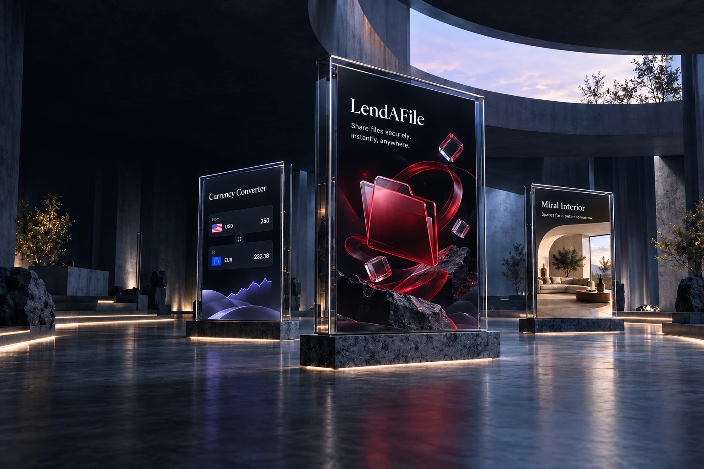
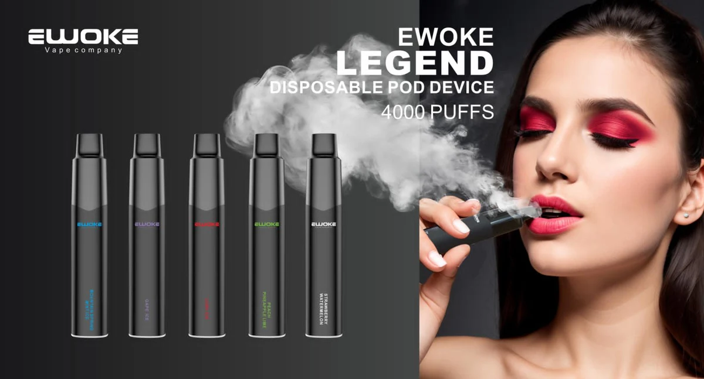
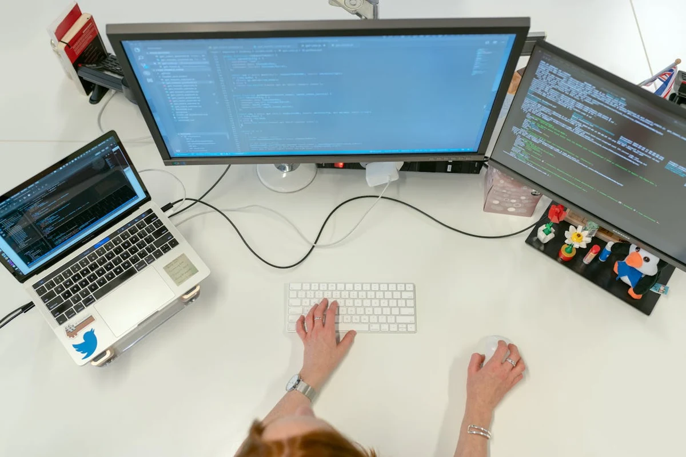
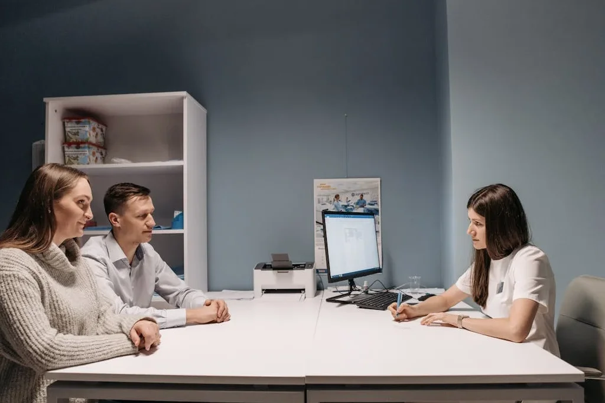

<h1>Built to be explored.</h1>

<b>Syed Anas Ali Askari</b> Full Stack Developer & Product Builder · Karachi, Pakistan

<a href="#the-collection">The collection</a> &nbsp; / &nbsp; <a href="#the-toolkit">The toolkit</a> &nbsp; / &nbsp; <a href="#behind-the-work">About</a> &nbsp; / &nbsp; <a href="https://www.linkedin.com/in/syedanasaliaskari/">LinkedIn</a>

<em>Considered code. Useful experiences.</em>

## Behind the work

I build web applications, connected backend systems and commercial websites. My work spans file sharing, e-commerce, healthcare, biotech, business tools and experiments.

I work with React, TypeScript, Node.js, NestJS, PHP and MySQL, with a focus on clear interfaces and maintainable systems.

## The toolkit

## The collection

**24 repositories · Products, commercial work and experiments**

Images marked *repository artwork* come from the project files. *Concept artwork* is a visual placeholder, not a product screenshot. Private repositories are showcased without exposing their source.

<table><tr><td width="50%" valign="top"><h3>01 / LendAFile</h3>
Concept artwork · Products

<b>File Sharing Platform</b>

Temporary file-sharing rooms, Quick Share and Quick Request, with QR sharing and optional password protection.

<code>PHP · JavaScript · Python</code>

<a href="https://lendafile.com">Visit website ↗</a> &nbsp; Private source
</td><td width="50%" valign="top"><h3>02 / Currency Converter</h3>
Concept artwork · Products

<b>React & NestJS Application</b>

React and NestJS currency conversion application with conversion history and server-side API credential handling.

<code>React · TypeScript · JavaScript</code>

<a href="https://ta-solutions.netlify.app/">Visit website ↗</a> &nbsp; <a href="https://github.com/SyedAnasAliAskari/currency_convertor">View repository ↗</a>
</td></tr></table>

<table><tr><td width="50%" valign="top"><h3>03 / Miral Interior</h3>
Concept artwork · Commercial

<b>Interior Design & E-Commerce</b>

Commercial interior design and e-commerce web project, presenting services, portfolio content and products.

<code>PHP · JavaScript</code>

<a href="https://miralinterior.com/">Visit website ↗</a> &nbsp; Private source
</td><td width="50%" valign="top"><h3>04 / Coupon Website</h3>
Project repository artwork · Commercial

<b>Offers & Promotions Website</b>

Coupon Website is part of my development collection. The Coupon-Website repository contains the project source.

<code>PHP · JavaScript</code>

Private source
</td></tr></table>

<table><tr><td width="50%" valign="top"><h3>05 / Freelancing Website</h3>
Project repository artwork · Commercial

<b>Services Website</b>

Freelancing Website is part of my development collection. The Freelancing-Website repository contains the project source.

<code>PHP · JavaScript</code>

Private source
</td><td width="50%" valign="top"><h3>06 / Ewoke Vapes</h3>
Project repository artwork · Commercial

<b>Product Catalogue</b>

Ewoke Vapes is part of my development collection. The Ewoke-Vapes repository contains the project source.

<code>PHP · JavaScript</code>

<a href="https://www.ewokevapes.com/pages/products.php">Visit website ↗</a> &nbsp; Private source
</td></tr></table>

<table><tr><td width="50%" valign="top"><h3>07 / Norvartis Biotech</h3>
Concept artwork · Commercial

<b>Biotechnology Website</b>

Norvartis Biotech is part of my development collection. The Norvartisbiotech-Website repository contains the project source.

<code>PHP · JavaScript</code>

Private source
</td><td width="50%" valign="top"><h3>08 / Nexnos Pharma</h3>
Project repository artwork · Commercial

<b>Pharmaceutical Website</b>

Nexnos Pharma is part of my development collection. The NexnosPharma-Website repository contains the project source.

<code>PHP · JavaScript</code>

Private source
</td></tr></table>

<table><tr><td width="50%" valign="top"><h3>09 / Reinziel Biotech</h3>
Concept artwork · Commercial

<b>Biotechnology Website</b>

Reinziel Biotech is part of my development collection. The RenizielBiotech-Website repository contains the project source.

<code>PHP · JavaScript</code>

Private source
</td><td width="50%" valign="top"><h3>10 / Beethovmed</h3>
Project repository artwork · Commercial

<b>Healthcare Website</b>

Beethovmed is part of my development collection. The Beethovmed-Website repository contains the project source.

<code>PHP · JavaScript</code>

Private source
</td></tr></table>

<table><tr><td width="50%" valign="top"><h3>11 / Saxon Digital</h3>
Project repository artwork · Commercial

<b>Digital Services Website</b>

Saxon Digital is part of my development collection. The SaxonDigitalTechnologies repository contains the project source.

<code>JavaScript</code>

<a href="https://saxondigitaltechnologies.netlify.app/">Visit website ↗</a> &nbsp; Private source
</td><td width="50%" valign="top"><h3>12 / Spark Digital</h3>
Project repository artwork · Commercial

<b>Digital Services Website</b>

Spark Digital is part of my development collection. The SparkDigitalTechnologies repository contains the project source.

<code>JavaScript</code>

<a href="https://4edgesolutions.netlify.app/">Visit website ↗</a> &nbsp; Private source
</td></tr></table>

<table><tr><td width="50%" valign="top"><h3>13 / Trademark Counsel</h3>
Concept artwork · Commercial

<b>Professional Services Website</b>

Trademark Counsel is part of my development collection. The TrademarkCounsel repository contains the project source.

<code>PHP</code>

<a href="https://trademarketing.netlify.app/">Visit website ↗</a> &nbsp; Private source
</td><td width="50%" valign="top"><h3>14 / Jacket E-Commerce</h3>
Concept artwork · Commercial

<b>E-Commerce Project</b>

Jacket E-Commerce is part of my development collection. The ECommerce_Jacket repository contains the project source.

<code>PHP · JavaScript</code>

Private source
</td></tr></table>

<table><tr><td width="50%" valign="top"><h3>15 / Picture-in-Picture Extension</h3>
Concept artwork · Products

<b>Browser Extension</b>

Picture-in-Picture Extension is part of my development collection. The pip-extension repository contains the project source.

<code>JavaScript</code>

Private source
</td><td width="50%" valign="top"><h3>16 / Ecommerce Crypto</h3>
Concept artwork · Experiments

<b>Repository Shell</b>

Ecommerce Crypto is part of my experimental collection. This repository currently has no committed project files.

<code>Repository shell</code>

Private source · No committed files yet
</td></tr></table>

<table><tr><td width="50%" valign="top"><h3>17 / Anxionyx Clinic</h3>
Concept artwork · Commercial

<b>Healthcare Website</b>

Anxionyx Clinic is part of my development collection. The anxionyxclinic repository contains the project source.

<code>PHP · JavaScript</code>

Private source
</td><td width="50%" valign="top"><h3>18 / Inventory Management</h3>
Concept artwork · Products

<b>Business Application</b>

Inventory Management is part of my development collection. The InventoryManagement repository contains the project source.

<code>PHP</code>

Private source
</td></tr></table>

<table><tr><td width="50%" valign="top"><h3>19 / Zloxs Pharma</h3>
Concept artwork · Commercial

<b>Pharmaceutical Website</b>

Zloxs Pharma is part of my development collection. The Zloxs-Pharma repository contains the project source.

<code>PHP · JavaScript</code>

Private source
</td><td width="50%" valign="top"><h3>20 / shhh</h3>
Concept artwork · Experiments

<b>Experimental Repository</b>

shhh is part of my experimental collection. The shhh repository contains the project source.

<code>JavaScript</code>

Private source
</td></tr></table>

<table><tr><td width="50%" valign="top"><h3>21 / Crypto E-Commerce</h3>
Concept artwork · Experiments

<b>E-Commerce Experiment</b>

Crypto E-Commerce is part of my experimental collection. The CryptoE_Commerce repository contains the project source.

<code>PHP · JavaScript</code>

Private source
</td><td width="50%" valign="top"><h3>22 / Helio Neuro Clinic</h3>
Project repository artwork · Commercial

<b>Healthcare Website</b>

Helio Neuro Clinic is part of my development collection. The HelioNeuroClinic repository contains the project source.

<code>PHP · JavaScript</code>

Private source
</td></tr></table>

<table><tr><td width="50%" valign="top"><h3>23 / GitHub Profile</h3>
Concept artwork · Experiments

<b>Developer Profile Repository</b>

GitHub Profile is part of my experimental collection. The SyedAnasAliAskari repository contains the project source.

<code>Python</code>

<a href="https://github.com/SyedAnasAliAskari/SyedAnasAliAskari">View repository ↗</a>
</td><td width="50%" valign="top"><h3>24 / Virtual Bluetooth Transmitter</h3>
Concept artwork · Experiments

<b>Bluetooth Audio Project</b>

Virtual Bluetooth Transmitter is part of my experimental collection. This repository currently has no committed project files.

<code>Repository shell</code>

<a href="https://github.com/SyedAnasAliAskari/Virtual-Bluetooth-Transmitter">View repository ↗</a> · No committed files yet
</td></tr></table>

## Let's build something useful

Web applications · Business websites · E-commerce interfaces · APIs & integrations

**[Connect on LinkedIn](https://www.linkedin.com/in/syedanasaliaskari/)** · **[Browse public repositories](https://github.com/SyedAnasAliAskari?tab=repositories)**

<!-- AUTO-REPOS:START -->
<!-- AUTO-REPOS:END -->
